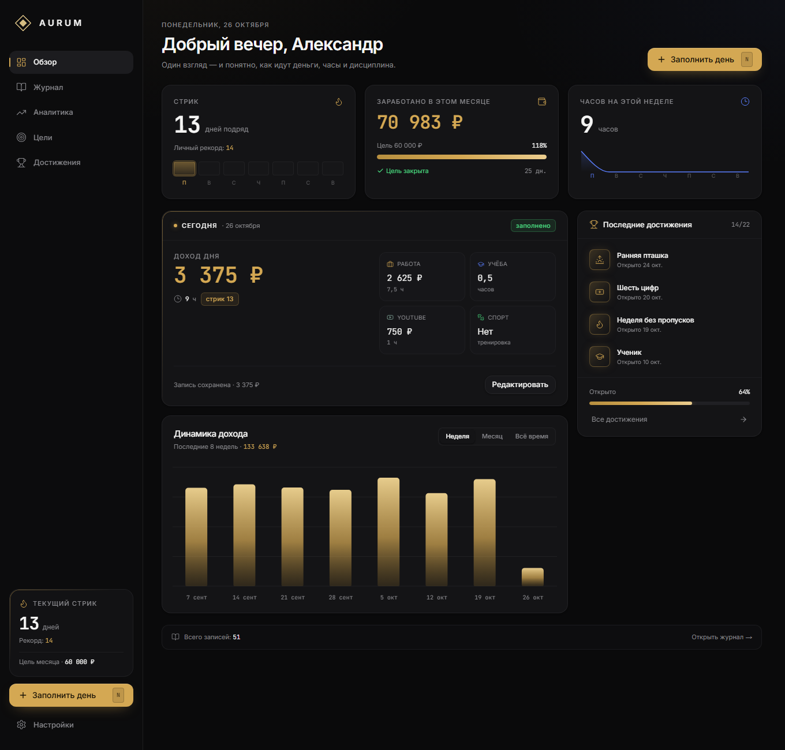
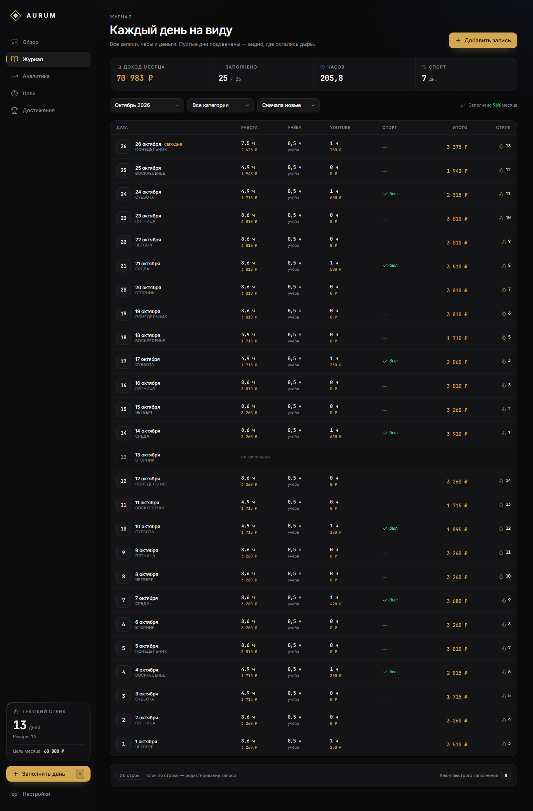
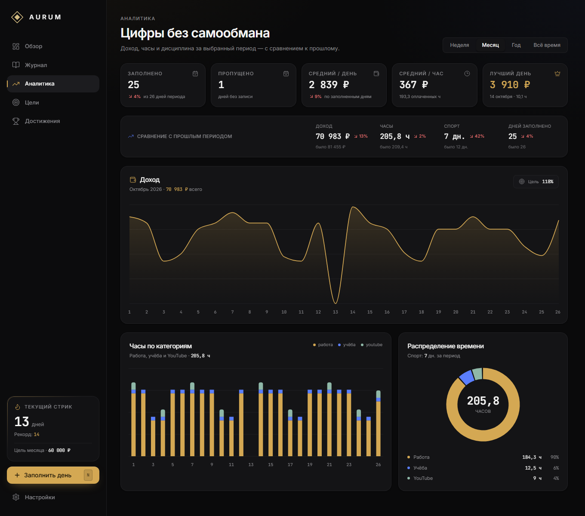
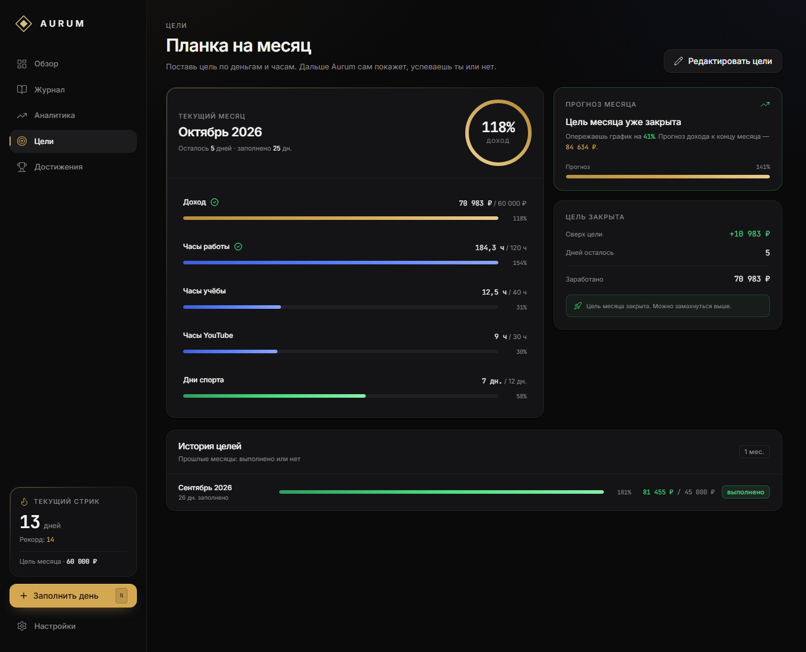
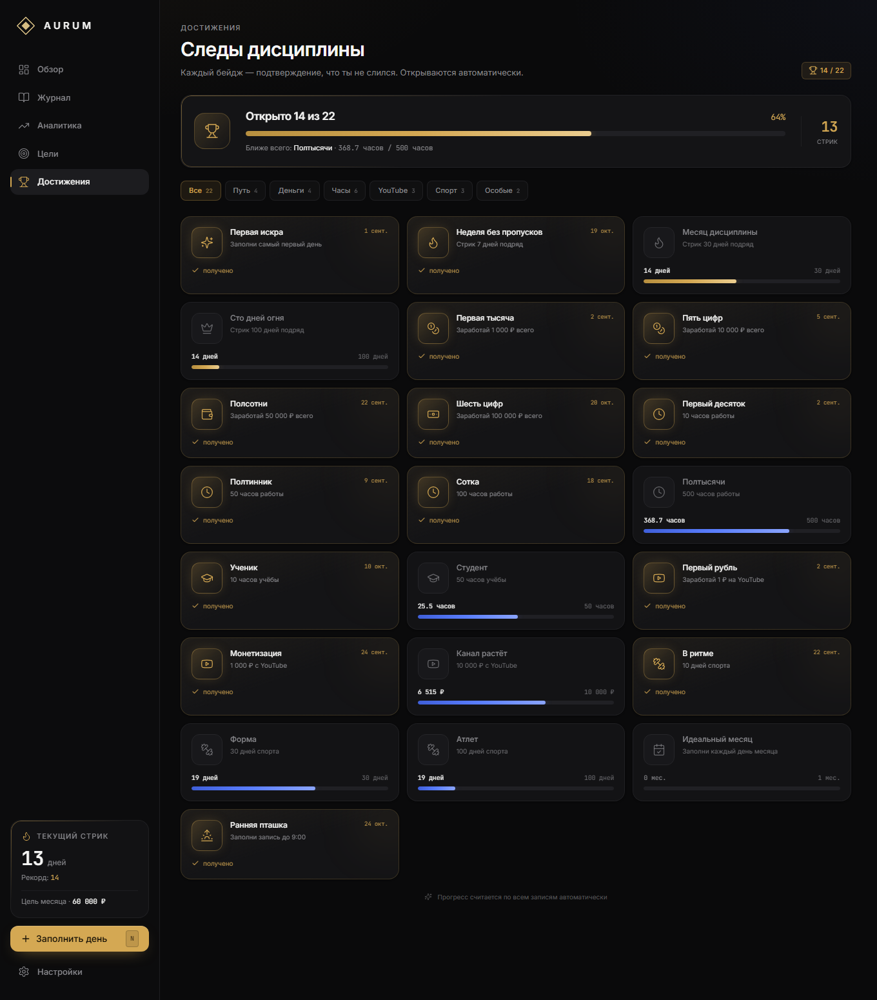
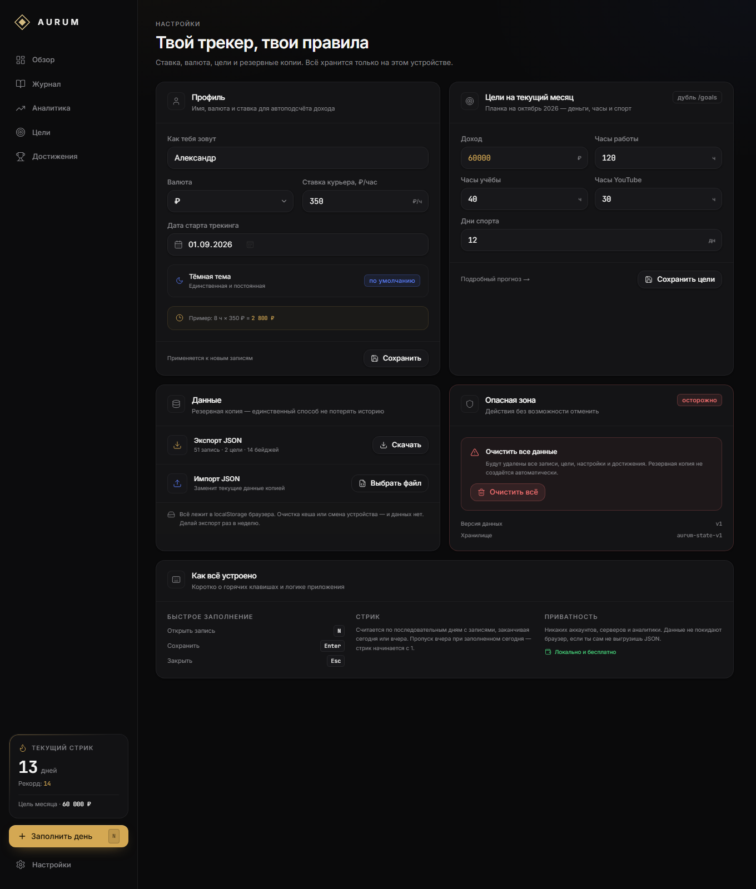
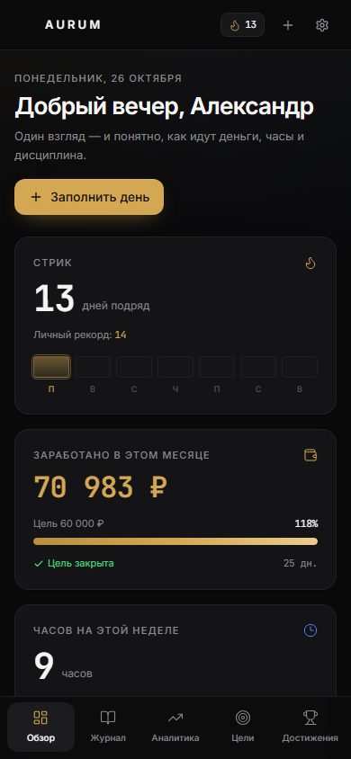
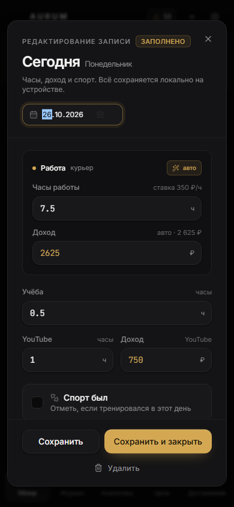

# Aurum

**Aurum** — премиальный трекер целей, дохода и дисциплины. Один экран показывает, сколько ты заработал, сколько часов вложил и не сломал ли стрик. Без аккаунтов, серверов и подписок: все данные лежат в браузере.



## Скачать

Готовые сборки лежат в [Releases](https://github.com/EKLER1K/Aurum/releases/latest):

- **Android** — `Aurum-1.04-Beta.apk` (Android 7.0+, подпись release-ключом);
- **Windows** — `Aurum-1.04-Beta-win.exe` (portable, x64, без установки).

Текущая версия — **V1.04 Beta**. Данные хранятся только на устройстве, аккаунт не нужен.

## Что внутри

- **Обзор** — приветствие, стрик с недельной полосой, доход месяца с прогрессом к цели, интерактивная карточка «Часов на этой неделе» с фильтром по целям в часах, карточка «Сегодня» со всеми целями месяца и целями на день, график дохода и последние достижения.
- **Журнал** — все дни месяца, включая пустые. Фильтры по категориям, сортировка по дате и доходу, редактирование и удаление записей, сводка месяца.
- **Аналитика** — доход, часы и спорт за неделю/месяц/год/всё время, сравнение с прошлым периодом, лучший день, пропуски, средний доход в час, графики и распределение времени.
- **Цели** — редактируемый список целей месяца (название, тип, единица, план, порядок), прогресс по каждой цели, прогноз дохода и история, а также отдельный список «Цели на день».
- **Достижения** — 22 бейджа в шести группах, прогресс до следующей награды, фильтры и даты открытия.
- **Настройки** — имя, круглый аватар с кроппером, валюта, ставка, режим администратора, сводка целей со ссылкой на вкладку «Цели», экспорт/импорт JSON, версия приложения и очистка данных с подтверждением.

Плюс: онбординг при первом запуске, быстрое заполнение по клавише `N`, авто-расчёт дохода по часам и ставке, ручное переопределение суммы, тосты о сохранении и закрытой цели, модальное окно с новым достижением, адаптив под мобильные.

## Скриншоты

| Обзор | Журнал |
| --- | --- |
|  |  |

| Аналитика | Цели |
| --- | --- |
|  |  |

| Достижения | Настройки |
| --- | --- |
|  |  |

| Мобильный обзор | Быстрое заполнение |
| --- | --- |
|  |  |

> Скриншоты сделаны на демонстрационных данных. В репозитории их нет — при первом запуске приложение показывает онбординг и пустые состояния.

## Стек

- **Next.js 15** (App Router, статическая генерация всех страниц) + **React 19**
- **TypeScript** в strict-режиме
- **Tailwind CSS 3.4** + компоненты в стиле **shadcn/ui** на Radix Dialog и Slot
- **Zustand 5** с `persist` в `localStorage`
- **Recharts 2** для графиков, **date-fns 4** для дат и русской локали
- **Framer Motion** для появления карточек и модального окна достижений
- **Lucide** для иконок, **Sonner** для тостов
- Шрифты **Inter** и **JetBrains Mono** через `next/font`

## Запуск

Требуется Node.js 18.18+ (рекомендуется 20+) и npm.

```bash
npm install
npm run dev
```

Открой [http://localhost:3000](http://localhost:3000). При первом запуске появится онбординг: имя, дата старта, ставка и цель на месяц.

Сборка и локальный запуск production-версии:

```bash
npm run build
npm run start
```

### Скрипты

| Команда | Что делает |
| --- | --- |
| `npm run dev` | Дев-сервер с горячей перезагрузкой |
| `npm run build` | Production-сборка (все страницы статические) |
| `npm run start` | Запуск собранного приложения |
| `npm run typecheck` | Проверка TypeScript без emit |
| `npm run android:sync` | Собрать статический сайт и скопировать его в Android-проект |
| `npm run android:build` | Собрать подписанный APK в `dist/` |
| `npm run android:open` | Открыть проект в Android Studio |
| `npm run win:dev` | Запустить Windows-приложение из исходников |
| `npm run win:build` | Собрать portable `.exe` в `dist/` |

## Android-приложение

Готовый установочный файл лежит в `dist/Aurum-1.04-Beta.apk` (около 7 МБ). Это то же приложение, упакованное в нативный Android-контейнер через Capacitor: все экраны, стили и данные работают без интернета.

### Установка на телефон

1. Перекинь `Aurum-1.04-Beta.apk` на телефон: по кабелю, через Telegram «Избранное», облако или почту.
2. Открой файл на телефоне. Android спросит разрешение на установку из этого источника — разреши для приложения, из которого открываешь файл (Файлы, Telegram, Chrome).
3. Нажми «Установить». Иконка **Aurum** появится в списке приложений.

Требования: Android 7.0 (API 24) и новее. Приложение не делает ни одного сетевого запроса. В манифесте остаётся стандартное разрешение `INTERNET` — оно нужно самому Android WebView-контейнеру, а не приложению: камера, геолокация, контакты и уведомления не запрашиваются. Фото профиля выбирается системным пикером Android, поэтому доступ ко всей галерее приложению тоже не нужен.

> APK подписан локальным ключом `android/keystore/aurum-release.jks`. Обновления «поверх» установятся только с тем же ключом: не удаляй и не пересоздавай его, иначе телефон откажется ставить новую версию и придётся удалять приложение вместе с данными. Сделай копию `.jks` и `android/keystore.properties` в надёжное место.

### Офлайн-режим

Внутри APK лежит полностью статическая сборка (`out/`), включая шрифты и иконки. Ни одного запроса в сеть: ни аналитики, ни шрифтов с CDN, ни проверки обновлений. Данные хранятся в `localStorage` WebView и остаются на устройстве.

Приложение не умеет работать «в интернете» — это отдельный установленный APK, а не сайт. Переустановка/удаление приложения стирает данные, поэтому перед сменой телефона делай экспорт.

### Перенос данных на другой телефон или ПК

**Экспорт (старое устройство):** Настройки → Данные → **Поделиться**. Файл `aurum-backup-ГГГГ-ММ-ДД.json` откроется в системном меню «Поделиться»: сохрани его в «Файлы», отправь в Telegram или на компьютер.

**Импорт (новое устройство):** Настройки → Данные → **Выбрать файл** (JSON из «Файлов» или загрузок) либо **Вставить** — скопируй текст копии в поле. Перед заменой данных показывается предпросмотр: сколько записей, целей и бейджей внутри.

На ПК тот же JSON импортируется в веб-версии: Настройки → Данные → «Выбрать файл». Формат один и тот же, потерь при переносе нет.

### Сборка APK из исходников

Нужны Node.js 20+, JDK 21 и Android SDK (platform 36, build-tools 36.0.0).

```powershell
# 1. Один раз: локальный ключ подписи
& "$env:USERPROFILE\.jdks\jdk-21*\bin\keytool.exe" -genkeypair `
  -keystore android\keystore\aurum-release.jks -alias aurum `
  -keyalg RSA -keysize 4096 -validity 10000 `
  -dname "CN=Aurum, O=Aurum, C=RU"

# 2. android\keystore.properties
#    storeFile=keystore/aurum-release.jks
#    storePassword=...
#    keyAlias=aurum
#    keyPassword=...

# 3. Сборка
npm run android:build
```

Скрипт делает `next build` (static export), удаляет тестовые данные из `out/`, вызывает `cap sync android`, собирает `assembleRelease` и проверяет подпись через `apksigner`. Результат копируется в `dist/Aurum-<версия>.apk`.

Если Gradle ругается на не-ASCII символы в пути, проверь `android.overridePathCheck=true` в `android/gradle.properties` — проект лежит в папке с кириллицей.

## Windows-приложение

Готовый файл: `dist/Aurum-1.04-Beta-win.exe` (около 106 МБ). Это **portable**-сборка: установка не нужна, права администратора не нужны, реестр не трогается. Файл можно переносить куда угодно — на рабочий стол, на флешку, в другую папку.

### Запуск

1. Двойной клик по `Aurum-1.04-Beta-win.exe`.
2. Первый запуск занимает 10–15 секунд: архив распаковывается во временную папку. Следующие запуски быстрее.
3. Открывается окно приложения 1280×900, его можно растягивать и разворачивать. Меню Windows убрано, всё управление внутри приложения.

Windows покажет предупреждение SmartScreen («Windows защитила ваш компьютер»), потому что файл не подписан платным сертификатом. Это ожидаемо: «Подробнее» → «Выполнить в любом случае». Приложение не скачивает ничего из сети и не требует установки — проверять подпись издателя здесь просто не у чего.

### Где хранятся данные

```
%APPDATA%\Aurum
```

Это профиль встроенного Chromium: там же, в `Local Storage`, лежит база приложения. Удаление этой папки (или очистка приложения в настройках Windows) стирает историю — как очистка кеша браузера. Перед переносом на другой компьютер делай экспорт.

### Экспорт и импорт

- **Экспорт:** Настройки → Данные → **Скачать**. Откроется обычное окно «Сохранить как» с предложенным именем `aurum-backup-ГГГГ-ММ-ДД.json`; по умолчанию — папка «Документы».
- **Импорт:** **Выбрать файл** или **Вставить** (текст JSON). Перед заменой данных показывается предпросмотр.
- Формат тот же, что у APK и веб-версии: копию с телефона можно открыть на компьютере и наоборот.

### Офлайн-режим

Внутри `.exe` лежат и приложение, и все экраны, шрифты и иконки. Сеть не используется вообще: ни аналитики, ни проверки обновлений, ни внешних шрифтов. Интернет нужен только чтобы скачать сам файл.

### Сборка

```powershell
npm install
npm run win:build
```

Нужны Node.js 20+ и интернет для первой загрузки Electron. Скрипт `scripts/build-win.mjs` собирает статический экспорт, убирает тестовые данные, упаковывает всё через `electron-builder` в portable-`.exe` и копирует результат в `dist/`.

Оболочка Electron — `electron/main.cjs`: она поднимает внутренний протокол `aurum://app` (стабильный origin, поэтому `localStorage` не теряется между запусками), отдаёт файлы из `out/`, перехватывает внешние ссылки в системный браузер и показывает нативное окно сохранения для резервной копии.

Иконка собирается из `assets/logo.svg`: `node scripts/make-icon.mjs` → `assets/icon.png`.

## Цели и ежедневные факты (V1.03 Beta)

В приложении два независимых списка целей.

### Цели месяца

Вкладка «Цели», верхняя карточка. По умолчанию: **Доход**, **Часы работы**, **Учёба**, **YouTube**, **Спорт**. Кнопка **«Редактировать»** открывает список, где можно:

- переименовать цель;
- добавить свою цель или удалить лишнюю (с подтверждением);
- выбрать тип — **число** (единица «часы» или «деньги») либо **галочка**;
- задать план на месяц;
- менять порядок стрелками **↑ / ↓** — этот порядок сразу наследуют ежедневная запись и обзор.

План месяца и ежедневные факты складываются в прогресс: для числовой цели — сумма значений, для галочки — количество отмеченных дней. Смена типа или единицы показывает предупреждение: старые значения и план **не конвертируются**. Если вернуть прежний тип до сохранения, привязка к журналу сохранится.

Встроенные цели читают старые поля записи, поэтому история не теряется:

- **Доход** — доход с работы плюс доход YouTube;
- **Часы работы**, **Учёба**, **YouTube** — соответствующие часы дня;
- **Спорт** — галочка «тренировался».

Новая денежная цель, созданная вручную, заполняется как обычная сумма за день. Автоподсчёт по ставке остаётся только у встроенного «Дохода»: `часы работы × ставка + доход YouTube`. Ручная сумма считается общим доходом дня.

### Цели на день

Отдельный список «Цели на день» на вкладке «Цели». У цели есть только название и тип — число (часы или деньги) или галочка. Месячного плана у неё нет: в ежедневную запись попадает только факт. Список не смешивается с целями месяца.

Если целей на день нет, показывается подсказка «Добавьте цели — они появятся в ежедневной записи». Если целей нет вообще, ежедневная запись предлагает перейти на вкладку «Цели».

### Ежедневная запись

Окно «Заполнить день» (клавиша `N`) показывает **все** цели месяца и цели на день обычными строками в сохранённом порядке:

- числовая цель — поле ввода с единицей (`ч` или валюта);
- галочка — кнопка «Отметить / Выполнено».

Стили, отступы и шрифты у строк одинаковые. Факты сохраняются кнопкой; заметка остаётся внизу. Галочки влияют только на факт дня — стрик и достижения считаются по записям журнала, как раньше.

### Фильтр «Часов на этой неделе»

Карточка на «Обзоре» кликабельна. В фильтр попадают только числовые цели с единицей «часы»:

- **Все цели** — все цели в часах, включая цели на день;
- **Только цели месяца** — без целей на день;
- **Выбрать вручную** — отметить конкретные цели.

Цифра, среднее за день и мини-график пересчитываются сразу; рядом показывается изменение к прошлой неделе. Галочки и деньги в недельную сумму не входят.

### Совместимость

Версия данных — **v3**. При обновлении:

- старые цели месяца (`goals`) переносятся в планы новых целей, история записей не меняется;
- цели и активности V1.01 (`customGoals`, `activities`) становятся целями на день и фактами в часах;
- резервные копии v1/v2 импортируются и нормализуются автоматически.

Старый интерфейс активностей и режимов «продуктив / перерыв» больше не используется.

## Фото профиля (V1.03 Beta)

Круглый аватар — главный элемент заголовка карточки «Профиль» на вкладке «Настройки». Пока фото нет, вместо него показывается крупный силуэт.

Нажми на аватар — из-под заголовка выезжает шторка «Фото профиля» и сдвигает остальные настройки вниз. Повторное нажатие на аватар, клик мимо шторки или по любому другому блоку страницы закрывает её. Внутри шторки — описание и кнопки выбора/удаления фото:

- **Android** — открывается системный пикер фото через `@capacitor/camera` (разрешение на доступ к галерее не запрашивается);
- **браузер и Windows** — обычный выбор файла.

После выбора открывается модалка с круглым кроппером (`react-easy-crop`): фото можно перетаскивать, масштаб меняется слайдером от 100% до 300%. «Сохранить» вырезает круглую область в canvas, сжимает её до 512×512 JPEG и кладёт в `settings.avatar` как base64 data URL. Кнопка «Удалить» возвращает силуэт.

Аватар хранится только на устройстве вместе с остальными данными, попадает в JSON-бэкап и восстанавливается импортом. В `sanitizeSettings` принимается только строка `data:image/...` (до ~2 МБ) или `null` — случайные и повреждённые значения отбрасываются.

## Как считается доход

У встроенной цели «Доход» есть два режима:

- **Авто** — `доход = часы работы × ставка` из настроек плюс доход YouTube. Сумма пересчитывается на лету при изменении часов.
- **Ручной** — конкретная сумма за день. Режим включается, если изменить сумму вручную; кнопка с волшебной палочкой возвращает автоподсчёт.

Доход месяца и графики строятся из значений цели «Доход». Если встроенную цель удалить, обзор возьмёт первую денежную цель месяца. Часы считаются отдельно: работа, учёба, YouTube и свои цели в часах. Денежные цели на день показываются в карточке «Цели на день» и не подмешиваются в месячный доход.

## Как считается стрик

Стрик — количество последовательных дней с записями, заканчивая сегодняшним или вчерашним днём.

- Если сегодня есть запись — цепочка идёт от сегодня.
- Если сегодня пусто, но вчера заполнено — стрик ещё жив и считается от вчера.
- Если пусто и сегодня, и вчера — стрик равен нулю.
- Личный рекорд — самая длинная серия за всё время; она не сбрасывается при пропуске.

На дашборде пропущенный вчерашний день подсвечивается отдельной плашкой с кнопкой «Заполнить вчера».

## Достижения

22 бейджа открываются автоматически при сохранении записи или импорте данных:

| Группа | Награды |
| --- | --- |
| Путь | первая запись, стрики 7 / 30 / 100 дней |
| Деньги | суммарный доход 1 000 / 10 000 / 50 000 / 100 000 ₽ |
| Часы | работа 10 / 50 / 100 / 500 ч, учёба 10 / 50 ч |
| YouTube | первый рубль, 1 000 / 10 000 ₽ |
| Спорт | 10 / 30 / 100 дней |
| Особые | идеальный месяц, запись до 9:00 |

Прогресс виден на странице достижений. Новые бейджи показываются в модальном окне по одному; если за одно действие открылось несколько — они встают в очередь. После импорта старых копий недостающие бейджи восстанавливаются без всплывающих окон.

## Режим администратора (V1.04 Beta)

На вкладке «Настройки» появилась карточка **«Режим администратора»** с тумблером. Подпись: «Позволяет редактировать и удалять любые достижения». Флаг хранится в `settings.adminMode` и переживает перезагрузку вместе с остальными данными.

Когда режим включён, на странице «Достижения»:

- появляется кнопка **«Добавить достижение»**;
- у каждого бейджа — включая все 22 встроенных — появляются кнопки **редактирования** (карандаш) и **удаления** (корзина);
- удаление подтверждается вторым кликом: кнопка превращается в «точно?»;
- встроенные бейджи можно переименовать, изменить описание, цель и иконку — метрика и группа остаются встроенными;
- свои достижения считаются по выбранной единице: **деньги** → общий доход, **часы** → суммарные часы, **дни** → количество заполненных дней; они попадают в группу «Особые».

Технически правки встроенных бейджей лежат в `achievementOverrides: Record<string, Partial<Achievement>>` и накладываются при рендере. Свои достижения хранятся в `customAchievements`, а ID удалённых — в `deletedAchievements`: удалённые бейджи не показываются и не учитываются в прогрессе. Старые JSON-бэкапы без этих полей импортируются с пустыми значениями, ничего не ломая.

Выключение режима убирает кнопки правки, но уже сделанные переопределения и свои достижения продолжают действовать.

## Данные и приватность

- Хранилище: `localStorage`, ключ `aurum-state-v1`.
- Никаких сетевых запросов, аккаунтов, cookies и аналитики. Данные не покидают устройство, если не выгрузить JSON вручную.
- Очистка кеша браузера, режим инкогнито или смена устройства означают потерю истории. Единственная страховка — регулярный экспорт.

### Формат резервной копии

Кнопка **Настройки → Данные → Экспорт JSON** скачивает файл `aurum-backup-ГГГГ-ММ-ДД.json`:

```json
{
  "app": "aurum",
  "exportedAt": "2026-10-26T09:00:00.000Z",
  "version": 3,
  "entries": {
    "2026-10-26": {
      "date": "2026-10-26",
      "workHours": 6,
      "workIncome": 2100,
      "studyHours": 1.5,
      "youtubeHours": 0.5,
      "youtubeIncome": 0,
      "sportDone": true,
      "note": "Спокойный день",
      "createdAt": "2026-10-26T07:30:00.000Z"
    }
  },
  "goals": {
    "2026-10": {
      "month": "2026-10",
      "incomeGoal": 60000,
      "workHoursGoal": 120,
      "studyHoursGoal": 40,
      "youtubeHoursGoal": 20,
      "sportDaysGoal": 16
    }
  },
  "monthGoals": [
    { "id": "income", "title": "Доход", "type": "number", "unit": "money", "preset": "income" },
    { "id": "work", "title": "Часы работы", "type": "number", "unit": "hours", "preset": "work" },
    { "id": "study", "title": "Учёба", "type": "number", "unit": "hours", "preset": "study" },
    { "id": "youtube", "title": "YouTube", "type": "number", "unit": "hours", "preset": "youtube" },
    { "id": "sport", "title": "Спорт", "type": "check", "preset": "sport" },
    { "id": "english", "title": "Английский", "type": "number", "unit": "hours" }
  ],
  "dayGoals": [
    { "id": "reading", "title": "Чтение", "type": "number", "unit": "hours" },
    { "id": "no-sugar", "title": "Без сахара", "type": "check" }
  ],
  "goalPlans": {
    "2026-10": { "income": 60000, "work": 120, "study": 40, "youtube": 20, "sport": 16, "english": 10 }
  },
  "dayValues": {
    "2026-10-26": { "english": 1, "reading": 0.5, "no-sugar": true }
  },
  "settings": {
    "name": "Александр",
    "currency": "₽",
    "defaultHourlyRate": 350,
    "trackingStartDate": "2026-09-01",
    "avatar": null,
    "avatarZoom": 1
  },
  "achievements": {
    "first_spark": { "unlockedAt": "2026-09-01T18:12:00.000Z" }
  },
  "onboarded": true
}
```

Импорт принимает как этот формат, так и внутренний объект Zustand (`{ "state": { ... }, "version": 3 }`), а также копии v1/v2 и V1.01 (`customGoals` + `activities`). Значения проверяются и нормализуются: даты должны быть валидными, числа — неотрицательными, неизвестные бейджи, цели и факты удалённых целей отбрасываются. Импорт **заменяет** текущие данные, поэтому перед ним показывается предпросмотр с количеством записей, целей и достижений.

Сброс удаляет записи, цели, настройки и достижения без возможности отмены — подтверждение обязательное.

## Горячие клавиши

| Клавиша | Действие |
| --- | --- |
| `N` | Открыть быстрое заполнение на сегодня |
| `Enter` | Сохранить запись из формы |
| `Esc` | Закрыть диалог |

`N` не срабатывает, когда фокус в поле ввода, и скрыт на мобильных подсказках.

## Структура проекта

```text
src/
  app/
    page.tsx                 # Обзор
    log/page.tsx             # Журнал
    stats/page.tsx           # Аналитика
    goals/page.tsx           # Цели
    achievements/page.tsx    # Достижения
    settings/page.tsx        # Настройки
    layout.tsx               # Шрифты, метаданные, провайдеры
    globals.css              # Токены, фон, утилиты
  components/
    app-shell.tsx            # Сайдбар и мобильная навигация
    providers.tsx            # Гидратация, горячие клавиши, тосты, диалоги
    quick-log-dialog.tsx     # Форма записи дня: все цели строками
    goals-manager.tsx        # Цели на день: создание, переименование, тип
    avatar-button.tsx        # Аватар в заголовке «Профиль» и переключатель шторки
    avatar-uploader.tsx      # Шторка «Фото профиля»: выбор и удаление
    avatar-cropper.tsx       # Модалка с круглым кроппером и зумом
    hours-filter-dialog.tsx  # Фильтр «Часов на этой неделе»
    onboarding-dialog.tsx    # Первый запуск
    achievement-celebration.tsx
    achievement-editor-dialog.tsx # Создание и правка достижений (админ)
    dashboard-charts.tsx
    stats-charts.tsx
    ui/                      # Button, Card, Dialog, Input, Select, Progress...
  lib/
    types.ts                 # Модель данных v3
    goals.ts                 # Дефолтные цели, типы, санитайзеры, форматирование
    store.ts                 # Zustand + persist, миграции, импорт/экспорт/сброс
    selectors.ts             # Стрики, итоги, прогресс целей, недельные часы
    image.ts                 # Чтение файла, base64 и canvas-кроп аватара
    version.ts               # V1.04 Beta
    achievements.ts          # 22 бейджа и условия
    format.ts                # Русские даты, деньги, склонения
    ui-store.ts              # Состояние диалогов
docs/                        # Скриншоты для README
```

## Модель данных

```ts
interface GoalDef {
  id: string;
  title: string;
  type: "number" | "check";
  unit?: "hours" | "money";          // только для type === "number"
  preset?: "income" | "work" | "study" | "youtube" | "sport";
  createdAt?: string;
}

interface AppData {
  version: number;                    // 3
  entries: Record<string, DayEntry>;  // ключ — "2026-10-26"
  goals: Record<string, MonthGoal>;   // совместимый слепок для статистики
  monthGoals: GoalDef[];              // порядок = порядок везде
  dayGoals: GoalDef[];                // отдельный список без плана
  goalPlans: Record<string, Record<string, number>>;      // "2026-10" → goalId → план
  dayValues: Record<string, Record<string, number | boolean>>; // дата → goalId → факт
  settings: Settings;
  achievements: Record<string, { unlockedAt: string }>;
  achievementOverrides: Record<string, Partial<Achievement>>; // правки встроенных
  customAchievements: CustomAchievement[]; // свои достижения
  deletedAchievements: string[];           // ID скрытых бейджей
  onboarded: boolean;
}
```

Запись дня по-прежнему хранит часы и доход по работе и YouTube, часы учёбы, флаг спорта, заметку и время создания — благодаря этому продолжают работать графики, стрик и достижения. Цели месяца читают эти поля через `preset`; у пользовательских целей факты лежат в `dayValues`, а планы — в `goalPlans`. `goals` остаётся зеркалом планов для старых селекторов и резервных копий. Все производные значения (итоги, стрики, проценты, прогнозы, недельная сумма с фильтром) считаются селекторами и не дублируются в хранилище.

## Дизайн

Тёмная тема без переключателя: глубокий графит `#0A0A0B`, карточки `#141416`, границы `#262629`, золотой акцент `#D4A853`, синий `#5B7FFF`, зелёный `#4ADE80`, красный `#F87171`. Заголовки — Inter, все цифры — JetBrains Mono с табличными знаками. Никакого неона, стекломорфизма и эмодзи; единственное исключение — пламя стрика.

## Ограничения

- Однопользовательское локальное приложение: нет авторизации, синхронизации и облака.
- Данные привязаны к браузеру и домену; перенос — только через JSON.
- Автоматических резервных копий нет.

---

Сделано как личный инструмент: минимум действий на запись, максимум честных цифр.
